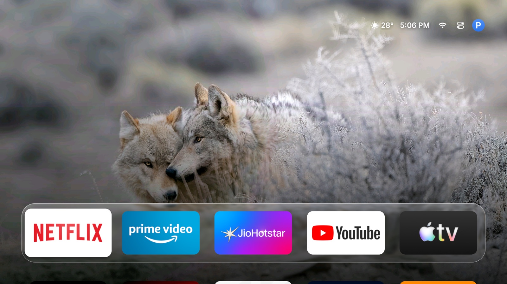

# tvOS layer for Fire TV

Turn an Amazon Fire TV Stick into something that behaves like an Apple TV: a
tvOS-style home screen with a glass dock, a Home button that actually goes
there, and none of Amazon's ad-filled launcher.

Built and tested on a **Fire TV Stick 4K Max (AFTSSS)**, Fire OS 7.7.1.7
(PS7717/5741), Android 9 / SDK 28, 1 GB RAM. Reversible: no root, no flashing,
nothing uninstalled that cannot be reinstalled.

<p align="center">
  
</p>

## What this is

| Piece | Package | What it does |
|---|---|---|
| **Home screen** | `com.getisolated.canvasos` | [canvasOS](https://github.com/getisolated/canvasOS), **rebuilt in English** — see [patches/](patches/) |
| **HOME redirect** | `com.firetv.tvos` | Our app. Catches Amazon's home and puts ours in front — [home-watcher/](home-watcher/) |
| **Tooling** | `scripts/`, `tools/` | Install, health check, undo, and tile-art generation |

This is a **front-end layer**, not a firmware. Fire OS's bootloader is locked
and signed by Amazon; nothing can be flashed over Wi-Fi. Amazon's launcher is a
*protected package* and stays installed — the layer simply owns the screen.

## The hard part: making HOME work

Every guide gets this wrong, so it is worth writing down. Fire OS 7 blocks the
obvious approaches:

- `pm disable-user com.amazon.tv.launcher` → **"Cannot disable a protected package"**
- `pm disable-user com.amazon.firehomestarter` → same
- `cmd package set-home-activity …` → returns *Success*, but Amazon's launcher
  still wins HOME (its intent filter has priority 950 and `firehomestarter`
  re-asserts it)
- filtering `KEYCODE_HOME` in an accessibility service → Fire OS handles HOME
  **before** any accessibility key filter runs

So the watcher does this:

1. An accessibility service watches for Amazon's home reaching the foreground.
2. It covers the screen with a black overlay, so Amazon's home is never seen.
3. It fires an **AlarmManager alarm whose PendingIntent is the launcher activity itself**.
4. The alarm is started by `system_server`, which is **exempt** from Fire OS's
   `APP_SWITCH_DELAY_TIME` — a ~5 second hold applied to app launches after HOME.
5. The cover lifts once the launcher is up.

**Point 3 is the whole trick.** Wake your own receiver and call `startActivity`
from it, and the launch is attributed to *your* uid, so the 5 second hold
applies again — you get the classic "Amazon home for five seconds, then my
launcher". Pointing the alarm straight at the activity makes `system_server` do
the launch.

Two settings matter:

```bash
adb shell settings put global alarm_manager_constants min_futurity=0
adb shell appops set com.firetv.tvos SYSTEM_ALERT_WINDOW allow
```

**Measured on this stick:** HOME → launcher in **175–290 ms**, no Amazon frames
visible.

### The second trap: Settings lives in the same package

The Amazon launcher package also hosts the TV's real Settings screen
(`com.amazon.tv.launcher.ui.MainSettingsActivity`). A watcher that redirects on
*any* window from that package makes Fire TV Settings impossible to open — you
press Settings and get bounced home. The watcher checks the window's class name
and only redirects when it looks like a home screen (`HomeActivity`,
`FireHomeStarter`).

## Install

Requires `adb` on a computer on the same network as the TV, and ADB debugging on
(Settings → My Fire TV → About → press OK 7× → Developer Options).

You need the canvasOS APK. Upstream ships French only, so this repo carries the
English translation as a patch instead of a binary:

```bash
git clone https://github.com/getisolated/canvasOS
cd canvasOS && git apply ../patches/canvasos-english.patch
export JAVA_HOME=$(/usr/libexec/java_home -v 17) ANDROID_HOME=$HOME/Android/sdk
./gradlew assembleStandardRelease
# -> app/build/outputs/apk/standard/release/app-standard-release.apk
```

Then:

```bash
adb connect <TV_IP>:5555          # accept the prompt on the TV
bash scripts/install_tvos_layer.sh <TV_IP>:5555 path/to/app-standard-release.apk
```

The script installs canvasOS and the watcher, makes canvasOS the home activity,
grants the ADB-only permissions, switches on the tvOS look (parallax focus,
liquid-glass Control Center, boot animation) and arms the HOME redirect.

Check it:

```bash
bash scripts/healthcheck.sh <TV_IP>:5555
```

## Undo

```bash
bash scripts/uninstall_tvos_layer.sh <TV_IP>:5555
```

That removes the watcher and canvasOS and puts Amazon's launcher back in charge.
Nothing else on the TV is touched.

## Tile art

canvasOS draws each tile from the app's own banner, which leaves some apps as a
bare icon on a flat gradient. Faces can be overridden one file per package:

```
/sdcard/Android/data/com.getisolated.canvasos/files/tiles/<package>.jpg    # 800×450
```

`tools/make_tvos_faces.py` draws Apple-style dark-glass faces from a folder of
APKs; `tools/make_youtube_tile.py` is the SmartTube-as-YouTube example
(`dist/youtube-tile-org.smarttube.stable.jpg`).

## What is in here

| Path | |
|---|---|
| `home-watcher/` | The HOME redirect (Java, ~340 lines) |
| `patches/canvasos-english.patch` | Full English translation of canvasOS's UI |
| `scripts/` | `install_tvos_layer.sh`, `healthcheck.sh`, `uninstall_tvos_layer.sh`, plus the older debloat helpers |
| `tools/` | Tile-art generators |
| `docs/CANVASOS-SETUP.md` | The exact state of one working box, with commands |
| `docs/LEGACY-CLEANYOURTV.md` | The earlier cleanyourtv-based attempt, kept for reference |

## Security note

ADB over the network is a real exposure: anything that can reach port 5555 with
an authorised key can drive the TV. Keep the Stick on a private network, and
when you no longer need remote access:

```bash
adb shell settings put global adb_enabled 0
```

Note that canvasOS's **Sleep**, **Turn Off** and **Free Up Memory** controls use
the TV's *local* ADB (the TV talking to itself), so turning debugging off
disables those buttons.

## Credits and licensing

- [canvasOS](https://github.com/getisolated/canvasOS) by getisolated — the home
  screen, and the source of the design this layer is built around. **It carries
  no licence**, so this repository does not redistribute its code or APKs: the
  English work is published as `patches/canvasos-english.patch`, applied to a
  clone you make yourself, for personal use on your own TV.
- The AlarmManager redirect technique and the Fire OS notes follow
  [Aerial](https://github.com/pengchujin/aerial-tv) (MIT, © 2026 pengchujin).
- Apple TV, tvOS and the Apple TV logo are trademarks of Apple Inc.; Amazon,
  Fire TV and Fire OS are trademarks of Amazon. The YouTube mark belongs to
  Google. This project is not affiliated with or endorsed by any of them.
- Our own code here (the watcher, scripts, tools, docs) is MIT.
